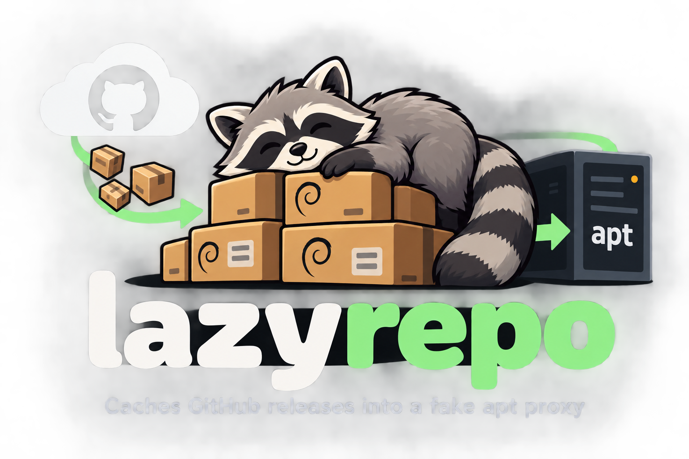
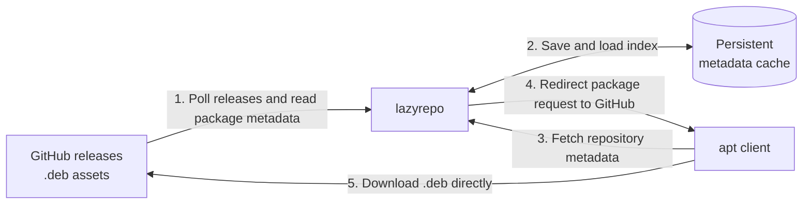

<p align="center">
  
</p>

# lazyrepo

**GitHub release assets, available through apt.**

lazyrepo turns GitHub repositories that publish `.deb` files into an apt repository.
Run one small service, point it at your repositories, and let clients install and
upgrade packages with their usual apt commands.

- Track multiple GitHub repositories with optional asset filters.
- Serve a flat apt repository without maintaining a package mirror.
- Keep package metadata in a persistent cache across restarts.
- Run with Docker Compose, Kubernetes, or a standalone Go binary.

## How it works



lazyrepo polls on startup and then at the configured interval. It skips draft and
prerelease releases, downloads new matching assets to read their Debian control
metadata, and saves the index. Package bytes are read during indexing but are
**never retained or served as a mirror**. Client package requests receive an HTTP
302 redirect to the original GitHub release asset.

The repository exposes `Packages`, `Packages.gz`, and an unsigned `Release` file.
Clients use the flat repository layout (`./`), without suites or components.

## Quick start with Docker Compose

Requires Docker with the Compose plugin.

```bash
git clone https://github.com/teamzuzu/lazyrepo.git
cd lazyrepo
cp config.example.yaml config.yaml
```

Edit `config.yaml` to list the repositories you want to track, then start:

```bash
docker compose up -d
docker compose logs -f lazyrepo
```

The supplied Compose file publishes port **8080** and stores the index in a named
volume. Wait for the initial poll to finish, then check the service:

```bash
curl -fsS http://localhost:8080/healthz
curl -fsS http://localhost:8080/Packages
```

Confirm that `Packages` contains the packages you expect; a listening server alone
does not mean indexing has completed. Stop with `docker compose down`; the named
volume is retained unless explicitly removed.

## Configure tracked repositories

```yaml
listen: ":8080"
poll_interval: 15m
cache_file: /data/index.json

repos:
  - repo: rcarmo/pve-microvm

  # Optional: restrict a repository to selected asset names.
  # - repo: someorg/multi-deb-project
  #   asset_filter: 'agent-.*_amd64\.deb'
```

| Setting | Default | Purpose |
| --- | --- | --- |
| `listen` | `:8080` | HTTP listen address. |
| `poll_interval` | `15m` | Positive Go duration between polls, such as `5m` or `1h`. |
| `cache_file` | `./index.json` | Writable path for the persistent metadata index. |
| `repos` | Required | One or more GitHub repositories in `owner/name` format. |
| `repos[].asset_filter` | Any name ending in `.deb` | Optional regular expression for asset names. |

See [config.example.yaml](config.example.yaml) for a complete starting point.
Configuration is loaded at startup; restart the service after editing it. The
example uses `/data/index.json` for containers; choose a writable local path when
running the binary directly.

## Add the repository to an apt client

Replace the URL below with the address clients can reach. For local Docker use,
this might be `http://<server>:8080/`; for an HTTPS Ingress, use your public domain.

```bash
echo 'deb [trusted=yes] https://apt.example.com/ ./' \
  | sudo tee /etc/apt/sources.list.d/lazyrepo.list
sudo apt update
sudo apt install <package-name>
```

Future versions are available through `sudo apt update` and `sudo apt upgrade`
after lazyrepo's next successful poll.

**Repository metadata is unsigned.** `[trusted=yes]` opts this source out of apt's
repository signature verification. Use repositories and a service operator you
trust, and configure HTTPS when exposing the service over a network. Clients also
need access to GitHub to download redirected package assets.

## Deploy on Kubernetes

The [Kubernetes manifests](deploy/kubernetes) include a Deployment, Service,
Ingress, application ConfigMap, and a **1Gi persistent volume claim**. An Ingress
controller and a suitable StorageClass must be available in your cluster.

### Set your repositories and domain

| File | What to configure |
| --- | --- |
| [configmap.yaml](deploy/kubernetes/configmap.yaml) | Tracked GitHub repositories, polling interval, and asset filters. |
| [ingress.yaml](deploy/kubernetes/ingress.yaml) | Replace `apt.example.com`, choose an Ingress class if needed, and enable TLS. |
| [persistentvolumeclaim.yaml](deploy/kubernetes/persistentvolumeclaim.yaml) | Storage size and `storageClassName` if there is no suitable default. |
| [deployment.yaml](deploy/kubernetes/deployment.yaml) | Pin the image to a release tag or digest for production; adjust resources as needed. |

Point DNS for your domain at the Ingress controller. For HTTPS, create a certificate
Secret in the deployment namespace and enable the commented `tls` section in the
Ingress with the matching hostname and Secret name.

The public hostname belongs in the Ingress resource. The ConfigMap holds the
application's repository configuration; Kubernetes does not substitute ConfigMap
values into Ingress host rules.

### Apply and verify

```bash
kubectl create namespace lazyrepo
kubectl apply -k deploy/kubernetes -n lazyrepo
kubectl rollout status deployment/lazyrepo -n lazyrepo
kubectl logs -f deployment/lazyrepo -n lazyrepo
```

Create the namespace only if it does not already exist. After the initial poll,
check the public endpoints:

```bash
curl -fsS https://apt.example.com/healthz
curl -fsS https://apt.example.com/Packages
```

Readiness checks metadata serving and can pass before the initial poll completes.
Liveness checks TCP connectivity, allowing the service to keep serving a cached
index during upstream outages. Monitor `/healthz` and the logs for polling errors.
The Deployment uses one replica and `Recreate` updates to prevent concurrent cache
writers; expect a brief interruption during updates.

After changing the ConfigMap, apply it and restart to reload configuration:

```bash
kubectl apply -k deploy/kubernetes -n lazyrepo
kubectl rollout restart deployment/lazyrepo -n lazyrepo
kubectl rollout status deployment/lazyrepo -n lazyrepo
```

### Network access

Allow outbound HTTPS from lazyrepo to `api.github.com`, `github.com`, and GitHub
release asset hosts, including `release-assets.githubusercontent.com`. Clients
need access to your Ingress and the redirected GitHub download destinations.
The Kubernetes nodes also need access to `ghcr.io` to pull the container image.

## Run from source

Requires Go **1.22 or newer**. A C compiler is also needed for race-enabled tests
on supported platforms.

```bash
go mod download
go build -o lazyrepo ./cmd/lazyrepo
cp config.example.yaml config.yaml
# Edit config.yaml: use a writable cache_file, such as ./index.json.
./lazyrepo -config config.yaml
```

Development checks:

```bash
go build ./...
go vet ./...
go test -race ./...
```

The existing tests use local HTTP servers and synthetic Debian packages to cover
GitHub polling, package parsing, index rendering, and download redirects without
requiring live GitHub access.

## Troubleshooting

| Symptom | What to check |
| --- | --- |
| `Packages` is empty | Wait for the initial poll, inspect logs, and check repository names and asset filters. Drafts and prereleases are skipped. |
| `/healthz` returns 500 | The last poll had a repository or cache-write error. Check GitHub connectivity, API rate limits, and cache permissions. |
| Health is OK but a package is missing | Asset download and parsing failures are logged and skipped; inspect logs even when `/healthz` succeeds. Assets over 500 MiB are skipped. |
| Configuration changes have no effect | Restart the process; on Kubernetes, restart the Deployment after applying the ConfigMap. |
| Kubernetes pod stays Pending | Inspect PVC binding, the StorageClass, and scheduling events with `kubectl describe`. |
| Package downloads fail on clients | Clients follow redirects to GitHub, so check their access to the release asset URL as well as the repository service. |
| apt cannot find a package | Check `/Packages`, run `apt update`, and confirm the package supports the client's architecture. |

`/healthz` starts healthy before the first poll completes and does not guarantee
that every asset was indexed. Check both the logs and expected package entries
when validating a new deployment.
